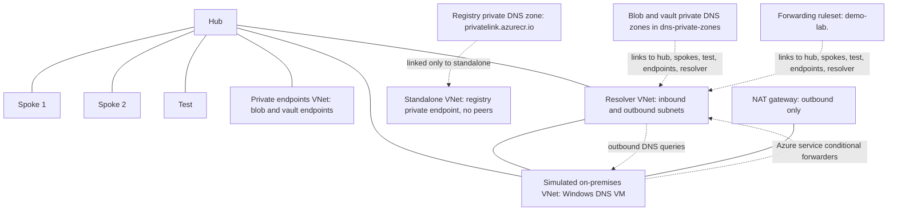

# Lab 00 - Scenario setup

[Back to the lab index](../README.md)

Reusable subscription-scoped Bicep for **two independent environments**: Subscription 1 / Tenant A and Subscription 2 / Tenant B. Each gets the same topology, its own DNS zones, Private Resolver, Storage account, Key Vault, Premium Azure Container Registry, and Windows DNS VM. There is **no cross-tenant connectivity or shared infrastructure**.

Nothing deploys automatically. Review costs and run validation/what-if before explicitly creating resources.

Run the commands below from this lab's directory:

```bash
cd lab-00-scenario-setup
```

## Files

```text
main.bicep
modules/
  network.bicep
  private-zones.bicep
  resolver.bicep
  private-services.bicep
  windows-dns.bicep
parameters/
  tenant-a.bicepparam
  tenant-b.bicepparam
scripts/
  Configure-Dns.ps1
  Test-Dns.ps1
  deploy.sh
  verify.py
tests/
  Test-ConfigureDns.ps1
  Test-DnsValidation.ps1
  test_scripts.py
```

## Topology

The following diagram applies **separately in each tenant**. Solid connections are bidirectional peerings; dotted connections describe DNS, not additional peerings.



| VNet | Tenant A prefix | Tenant B prefix | Subnets |
| --- | --- | --- | --- |
| Hub | 10.10.0.0/24 | 10.20.0.0/24 | workload: first /26 |
| Spoke 1 | 10.10.1.0/24 | 10.20.1.0/24 | workload: first /26 |
| Spoke 2 | 10.10.2.0/24 | 10.20.2.0/24 | workload: first /26 |
| Test | 10.10.3.0/24 | 10.20.3.0/24 | workload: first /26 |
| Private endpoints | 10.10.4.0/24 | 10.20.4.0/24 | workload: first /26; both private endpoints |
| Resolver | 10.10.5.0/24 | 10.20.5.0/24 | inbound: .0/28; outbound: .16/28 |
| Standalone | 10.10.6.0/24 | 10.20.6.0/24 | workload: first /26; registry private endpoint |
| Simulated on-premises | 10.10.7.0/24 | 10.20.7.0/24 | workload: first /26; Windows DNS at .4 |

Inbound resolver IPs are `10.10.5.4` and `10.20.5.4`. Blob and vault private endpoints use `.4` and `.5` in the endpoints subnet. All addresses can be overridden with the typed `vnetPrefixes` and `subnetPrefixes` parameters, `inboundIp`, `dnsVmIp`, `blobEndpointIp`, and `vaultEndpointIp`. Defaults derive from `labCidr`. Keep all VNet/subnet ranges nonoverlapping and endpoint addresses inside their subnets; Azure reserves the first four and last subnet addresses. Resolver subnets must be dedicated, delegated to `Microsoft.Network/dnsResolvers`, and within the service-supported /28 to /24 range. Static endpoint addresses are creation-time settings; changing them can require recreating the private endpoints.

Each environment creates four resource groups:

- `<prefix>-network`: VNets, peerings, resolver/ruleset, Windows DNS NSG, and egress NAT.
- `dns-private-zones`: blob, vault, and registry private DNS zones.
- `<prefix>-services`: Storage, Key Vault, Premium Container Registry, all three private endpoints and their DNS zone groups.
- `<prefix>-simulation`: Windows DNS VM/NIC and managed bootstrap Run Command.

Use fresh subscriptions or ensure these resource groups and private-zone namespaces are dedicated to this lab. The fixed `dns-private-zones` name means this template is **not designed for multiple lab instances in one subscription**. Storage/Key Vault/registry names use a deterministic subscription/resource-group/prefix hash.

The registry requires **Premium** because Azure Container Registry Basic does not
support private endpoints. Public network access, the admin account, and trusted
service network bypass are disabled. The endpoint uses dynamic private IPs for
the registry login and regional data endpoints in the standalone subnet. Its
DNS zone group creates the corresponding records in `privatelink.azurecr.io`.
Only the standalone VNet links to that zone. It has no peerings, resolver/ruleset
links, or links to the blob/vault zones. No container images or role assignments
are created. The shared template applies this configuration independently to
both tenant parameter files.

### DNS flows

1. **Azure private service names:** hub, spoke 1, spoke 2, test, endpoints, and resolver VNets retain Azure-provided DNS. Both `privatelink.blob.core.windows.net` and `privatelink.vaultcore.azure.net` have registration-disabled links to all six VNets. Normal Storage/Key Vault service names follow their public CNAME chains into these private zones, returning endpoint IPs.
2. **Fake on-premises names:** each of those six VNets has a ruleset link. Azure DNS applies `demo-lab.`, sends the request through the resolver outbound endpoint, and reaches Windows DNS over the resolver/on-premises direct peering. Windows DNS hosts authoritative zone `demo-lab` with `dns-test.demo-lab` pointing to its own private IP.
3. **Simulated on-premises to Azure:** Windows DNS conditionally forwards `blob.core.windows.net` and `vault.azure.net` to the resolver inbound IP. Inbound resolves through the resolver VNet's private-zone links. The simulated-on-premises VNet itself has **no private-zone or ruleset links**; VM network settings retain Azure DNS, and DNS service tests explicitly address its local Windows DNS server.
4. **Standalone registry:** Azure-provided DNS resolves the registry login and regional data names through the standalone-only `privatelink.azurecr.io` zone. No registry zone links or conditional forwarders are added to the hub, spokes, resolver, or Windows DNS.

There are no wildcard forwarding rules and no rules targeting the resolver's own inbound IP. Linking this ruleset to the resolver VNet is safe because its only destination is the authoritative Windows server.

### DNS resolution is not connectivity

**Peering is not transitive.** No hub router, UDRs, gateways, or sibling-VNet peerings are deployed.

| Source | Resolve private service names | Reach endpoint IP on TCP/443 |
| --- | --- | --- |
| Hub | Yes | Expected over its direct endpoints-VNet peering |
| Private endpoints VNet | Yes | Expected within the VNet |
| Spoke 1 / Spoke 2 / Test / Resolver | Yes | **No route through hub to sibling endpoints VNet** |
| Simulated on-premises VM querying its Windows DNS | Yes, through conditional forwarders | **No transitive route to endpoints VNet** |
| Standalone | Registry only; no blob/vault private-zone integration | Registry endpoint within its own VNet only |

Standalone means no peering or shared DNS/ruleset integration, with its own registry zone only, **not** guaranteed NXDOMAIN for a public Storage/Key Vault name. Public DNS can still answer. Public service access is disabled regardless. Even with working DNS and routing, service operations need appropriate Entra data-plane RBAC; this lab creates no role assignments, secrets, or blob data. Shared-key Storage authorization is disabled.

## Prerequisites

- Azure CLI with current Bicep CLI (`az bicep install`), Bash 4+, and Python 3.10+ for verification. PowerShell 7 is needed only for local bootstrap unit tests; Windows PowerShell/DNS cmdlets run on the Windows Server VM.
- Separate access to each tenant/subscription. Subscription Contributor is sufficient for lab resources and Run Command, subject to Azure Policy/deny assignments. Provider registration requires the relevant subscription-level `/register/action` permission. No role-assignment write permission is needed.
- A region supporting DNS Private Resolver, Standard NAT Gateway, and the selected Windows image/VM SKU, with sufficient Compute/vCPU and resolver quotas. Examples use `westeurope`, `Standard_B2s`, and Windows Server 2022 Azure Edition. Verify availability in both subscriptions; parameterize `vmSize`/`windowsImage` if necessary. Pin an image version if image reproducibility is required.
- Resource-group and private endpoint creation must be permitted by tenant policies. Confirm no existing similarly named resources will be adopted/modified.

### Local checks (no Azure login)

```bash
az bicep build --file main.bicep --outdir /tmp
az bicep lint --file main.bicep
bash -n scripts/deploy.sh
python3 -m unittest discover -s tests -p 'test_*.py' -v
pwsh -NoLogo -NoProfile -File tests/Test-ConfigureDns.ps1
pwsh -NoLogo -NoProfile -File tests/Test-DnsValidation.ps1
```

To compile example parameter files, use a throwaway test-only environment value and write output only to a disposable directory. **Do not run `build-params` with a real password**: compiled parameter JSON contains plaintext. The deployment helper uses environment-variable injection into a secure Bicep parameter, not password arguments or persistent parameter files.

```bash
mkdir -p .build
DNS_ADMIN_PASSWORD='Compile-only-not-a-real-secret-123!' \
  az bicep build-params --file parameters/tenant-a.bicepparam --outdir .build
DNS_ADMIN_PASSWORD='Compile-only-not-a-real-secret-123!' \
  az bicep build-params --file parameters/tenant-b.bicepparam --outdir .build
```

Local checks completed during implementation: Bicep build/lint and both parameter-file compilations passed without diagnostics; Bash syntax, four Python tests, four bootstrap mock scenarios, and three DNS-validation mock scenarios passed. The PowerShell tests mock Windows cmdlets; they are not live VM tests. No Azure login, ARM validation/what-if, deployment, or live DNS query was performed.

### Tenant A: sign in, register, inspect, deploy

Replace the four identity placeholders below with real GUIDs. Do not copy Tenant A subscription IDs into Tenant B commands.

```bash
TENANT_A_ID='<tenant-a-guid>'
SUBSCRIPTION_1_ID='<subscription-1-guid>'
TENANT_B_ID='<tenant-b-guid>'
SUBSCRIPTION_2_ID='<subscription-2-guid>'

az login --tenant "$TENANT_A_ID"
az account set --subscription "$SUBSCRIPTION_1_ID"
az account show --query '{subscription:id,tenant:tenantId}' -o table

for provider in Microsoft.Network Microsoft.Compute Microsoft.Storage Microsoft.KeyVault Microsoft.ContainerRegistry; do
  az provider register --subscription "$SUBSCRIPTION_1_ID" --namespace "$provider" --wait
done

bash scripts/deploy.sh validate tenant-a "$TENANT_A_ID" "$SUBSCRIPTION_1_ID"
bash scripts/deploy.sh what-if tenant-a "$TENANT_A_ID" "$SUBSCRIPTION_1_ID"
# Only after reviewing what-if, explicitly deploy:
bash scripts/deploy.sh create tenant-a "$TENANT_A_ID" "$SUBSCRIPTION_1_ID"
```

The helper checks the tenant associated with the explicitly named subscription. Each action silently prompts for the Windows administrator password; create also requires typing the environment/subscription confirmation. Use 12+ characters meeting Windows complexity requirements and the **same password on subsequent deployments** unless intentionally rotating it. Secrets exist only in process memory/environment and ARM secure parameters. Do not enable Azure CLI debug tracing, shell tracing around secret handling, or capture a real password in files/history.

The helper's `--location westeurope` sets the **subscription deployment metadata** location; resource locations come from the parameter file. Keep the metadata location unchanged for a given deployment name.

### Tenant B: separate authenticated deployment

```bash
az login --tenant "$TENANT_B_ID"
az account set --subscription "$SUBSCRIPTION_2_ID"
az account show --query '{subscription:id,tenant:tenantId}' -o table

for provider in Microsoft.Network Microsoft.Compute Microsoft.Storage Microsoft.KeyVault Microsoft.ContainerRegistry; do
  az provider register --subscription "$SUBSCRIPTION_2_ID" --namespace "$provider" --wait
done

bash scripts/deploy.sh validate tenant-b "$TENANT_B_ID" "$SUBSCRIPTION_2_ID"
bash scripts/deploy.sh what-if tenant-b "$TENANT_B_ID" "$SUBSCRIPTION_2_ID"
# Explicit operator action:
bash scripts/deploy.sh create tenant-b "$TENANT_B_ID" "$SUBSCRIPTION_2_ID"
```

There is deliberately no deployment orchestrator that assumes credentials valid in both tenants.

## Deployed validation

Sign into the appropriate tenant before running verification. These commands were **not** executed as part of generating the lab.

```bash
# Tenant A (repeat az login if needed):
python3 scripts/verify.py --tenant "$TENANT_A_ID" \
  --subscription "$SUBSCRIPTION_1_ID" --deployment dns-lab-tenant-a

# Also execute Test-Dns.ps1 through managed Run Command:
python3 scripts/verify.py --tenant "$TENANT_A_ID" \
  --subscription "$SUBSCRIPTION_1_ID" --deployment dns-lab-tenant-a --dns-tests

# Tenant B, after signing in there:
python3 scripts/verify.py --tenant "$TENANT_B_ID" \
  --subscription "$SUBSCRIPTION_2_ID" --deployment dns-lab-tenant-b --dns-tests
```

Configuration checks verify all directed peerings, default VNet DNS, exact private-zone/ruleset VNet link membership, the outbound endpoint association, the forwarding target, approved endpoint subresources/subnets/zone groups, actual endpoint NIC IPs against outputs, public service access disabled, and the bootstrap's actual instance-view execution state/exit code. Nonsecret deployment outputs include both private endpoint IPs and the VM/endpoint/resolver resource IDs.

Registry checks additionally enforce Premium, disabled admin/network bypass,
the standalone-only zone link, endpoint placement/approval, DNS zone group, and
login/regional data A records matching its dynamically allocated NIC IPs.
Outputs expose `standaloneZoneId` and `services.registryId`, `registryFqdn`,
and `registryEndpointId`; the existing `zoneIds` list remains blob/vault only.

DNS tests run **on the Windows VM**, without adding clients:

- Query resolver inbound for `dns-test.demo-lab` and require the Windows VM IP; repeat with TCP-only DNS.
- Query `168.63.129.16` directly for that name and require NXDOMAIN as a negative control for the unlinked simulated-on-premises VNet. Timeouts and other errors fail; they do not count as a successful negative test.
- Query local Windows DNS for the normal blob and Key Vault FQDNs; require exactly the actual corresponding endpoint IP.
- Fail explicitly if a managed Run Command reports failure/nonzero exit, even if its ARM provisioning state alone appears successful.

### Operator-run tests from other VNets

No client VMs are deployed in hub/spokes/test/standalone. From an independently provisioned Windows client in a linked VNet:

```powershell
Resolve-DnsName dns-test.demo-lab. -Server 168.63.129.16
Resolve-DnsName '<storage-name>.blob.core.windows.net' -Server 168.63.129.16
Resolve-DnsName '<vault-name>.vault.azure.net' -Server 168.63.129.16
Test-NetConnection '<blob-private-ip>' -Port 443
```

Expect the DNS results described above. TCP/443 should be reachable from hub or the endpoints VNet, but not from a spoke/test VNet through hub alone. From standalone, `demo-lab` should not have this lab's forwarding integration; public service DNS answers are not evidence of private connectivity. These operator tests are not performed by the verification script.

From a client in standalone, query `<registry-name>.azurecr.io` and
`<registry-name>.<region>.data.azurecr.io` against `168.63.129.16` and check that
both return standalone-subnet IPs; test TCP/443 to the registry login name.
Clients in other lab VNets have no private route to those IPs or link to the
registry zone. No standalone client VM is deployed, so the existing Windows
VM DNS tests do not test registry resolution from standalone.

## Security, egress, and costs

- No VM public IP, RDP/WinRM rule, Bastion, AD domain controller, extra VM, or cross-tenant peering. Use managed Run Command.
- Windows DNS inbound NSG TCP/UDP 53 allows only resolver inbound/outbound subnet CIDRs plus explicit `allowedDnsClientCidrs`; all other inbound traffic is denied. Bootstrap disables broad built-in DNS firewall rules and creates scoped replacements. Adding an allowed client CIDR does not create routing.
- The on-premises subnet has `defaultOutboundAccess: false` and an explicit **Standard NAT Gateway with an egress-only public IP**. No public IP is attached to the VM. NAT enables Windows servicing, activation, agent/extension downloads, and role/bootstrap dependencies without relying on implicit outbound access. It does not expose inbound listeners. Outbound NSG defaults permit outbound traffic: NAT is not an FQDN filter or production egress firewall.
- Other subnets also disable default outbound access. Managed DNS resolver egress is handled by the Azure service; do not attach the DNS VM NAT to dedicated resolver subnets.
- **Recurring costs:** DNS Private Resolver inbound/outbound endpoints and ruleset links/queries as billed; Windows VM compute/licensing, managed OS disk and boot diagnostics; NAT gateway hourly/data processing and Standard public IPv4; private endpoints, private DNS zones/queries, peering transfer, Storage and Key Vault usage; **Premium Container Registry in each tenant**, including its additional private endpoint and DNS zone. There is one complete set in each tenant. Check the Azure pricing calculator for your region.
- VM deallocation stops compute billing, not disks, Private Resolver, NAT, private endpoints, or other retained resources. Delete the lab when finished.
- Key Vault soft delete retains its name after deletion (7-day retention here); immediate redeployment using the same prefix can require deliberate recovery or purge with separate permissions. Purge protection is not enabled for this disposable lab. Never purge unrelated vaults.

## Troubleshooting

- **Bootstrap failure:** inspect managed Run Command `configure-dns` instance view, Windows feature-install errors, NAT/subnet association, and VM agent health. Installation requiring a restart fails explicitly; remediate and redeploy. Bootstrap is idempotent and refuses conflicting DNS zone types/non-A sample records rather than silently overwriting them.
- **DNS timeout:** check both directions of resolver/on-premises peering, DNS service state, NSG and Windows Firewall source CIDRs, and static IPs. Outbound resolver queries originate from its dedicated outbound subnet, not the inbound VIP.
- **Public instead of private addresses:** check private endpoint approval, zone-group records, zone-link membership and Windows conditional forwarders. Allow for normal DNS caching/propagation; retry validation after clearing the DNS cache, not by accepting an incorrect address.
- **demo-lab fails only in an Azure VNet:** check that VNet's ruleset link and the enabled trailing-dot rule. Peering by itself does not apply private DNS zones or rulesets.
- **TCP timeout after successful DNS:** compare the source to the routing matrix. This is expected between sibling VNets in this topology.
- **403 after a working connection:** verify the caller's data-plane role and token audience. Do not re-enable public access or shared keys to mask an authorization problem.
- **Deployment validation errors:** verify region/service/image availability, quotas, globally unique names, provider registration and Azure Policy. Run what-if again after edits.

## Explicit cleanup

Only run these commands if all four groups are **dedicated to this lab**. Deleting `dns-private-zones` also deletes anything else that someone added there. Review group contents and the `lab` tag first. Commands intentionally keep Azure's interactive deletion confirmation and do not purge Key Vaults.

```bash
az login --tenant "$TENANT_A_ID"
az account set --subscription "$SUBSCRIPTION_1_ID"
az account show --query '{subscription:id,tenant:tenantId}' -o table
az group list --subscription "$SUBSCRIPTION_1_ID" --tag lab=dnslab-a -o table
az group delete --subscription "$SUBSCRIPTION_1_ID" --name dnslab-a-services
az group delete --subscription "$SUBSCRIPTION_1_ID" --name dns-private-zones
az group delete --subscription "$SUBSCRIPTION_1_ID" --name dnslab-a-simulation
az group delete --subscription "$SUBSCRIPTION_1_ID" --name dnslab-a-network

az login --tenant "$TENANT_B_ID"
az account set --subscription "$SUBSCRIPTION_2_ID"
az account show --query '{subscription:id,tenant:tenantId}' -o table
az group list --subscription "$SUBSCRIPTION_2_ID" --tag lab=dnslab-b -o table
az group delete --subscription "$SUBSCRIPTION_2_ID" --name dnslab-b-services
az group delete --subscription "$SUBSCRIPTION_2_ID" --name dns-private-zones
az group delete --subscription "$SUBSCRIPTION_2_ID" --name dnslab-b-simulation
az group delete --subscription "$SUBSCRIPTION_2_ID" --name dnslab-b-network
```

If you change prefixes, adjust cleanup names deliberately. Subscription deployment records can be removed separately; deleting a deployment record does not delete resources.

## References

- [Private Resolver endpoints, links and loop avoidance](https://learn.microsoft.com/azure/dns/private-resolver-endpoints-rulesets)
- [Private endpoint DNS integration](https://learn.microsoft.com/azure/private-link/private-endpoint-dns-integration)
- [Managed Run Command on Windows](https://learn.microsoft.com/azure/virtual-machines/windows/run-command-managed)
- [Explicit outbound connectivity and private subnets](https://learn.microsoft.com/azure/virtual-network/ip-services/default-outbound-access)
